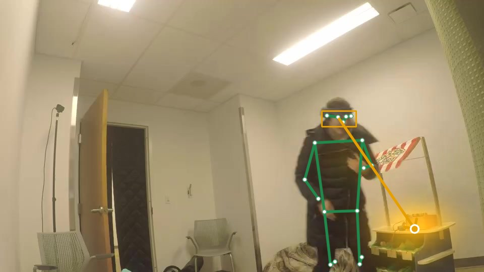

# eeg_sync

Pose, gaze, and synchrony analysis for parent–child interaction videos, plus an interactive EEG ↔ video synchronization tool. Originally built for the Cayo Santiago studies; now a general video → analyzable outputs pipeline.



*One frame of pipeline output: the adult's 17-keypoint pose (green) and the PaGE
gaze estimate (orange arrow from the head box to the predicted gaze target; the
glow is the gaze heatmap).*

> **New here?** Go to [`docs/COLLEAGUE_QUICKSTART.md`](docs/COLLEAGUE_QUICKSTART.md). It's the one doc to read.
>
> **Driving this with an LLM?** Point it at [`docs/PIPELINE.md`](docs/PIPELINE.md), [`docs/INPUTS.md`](docs/INPUTS.md), and [`docs/OUTPUTS.md`](docs/OUTPUTS.md). All three are written for both humans and machines.

---

## What this does

Given one or two videos of a parent–child session, the pipeline produces:

- **Per-frame pose for exactly the parent and the child** — boxes + 17 COCO
  keypoints per person (CSV). Every detection is cached, and an offline
  two-person association uses about 10 anchor frames labeled per camera
  ("which one is the parent?"). ViTPose-Large then refines the keypoints.
- **Per-frame gaze estimates** — PaGE ViT-B gaze heatmaps and gaze points
  per person (CSV + NPZ).
- **Per-block metrics** — torso proximity and movement synchrony. Gaze
  categories (mutual gaze, joint attention, parent/child watching, …) are
  reported next to their **chance level**. Every block also reports
  **tracking coverage** (share of frames with both people found), so
  low-coverage blocks are flagged rather than silently averaged.
- **A one-page `report.html` and `session_metrics.csv` per session**, plus an
  all-sessions table for the whole study.
- **Overlay videos** of the start and end of every block to check tracking by eye.

Optionally, it also synchronizes those videos with OpenBCI EEG recordings.

---

## Video Processing Portal (recommended)

Non-technical users run everything through a password-protected web portal on
the lab workstation:

```powershell
.\start-portal.ps1          # prompts for a password, prints a public link
.\start-portal.ps1 -NoTunnel  # local only: http://localhost:8080
```

In the browser the user:

1. Uploads Video A and/or B. Each video's task blocks (e.g.
   `grocery,16:00,26:50`) and extra-person windows are entered **in that
   video's own clock**; the two GoPros' clocks differ.
2. Waits for pose inference (about 2 minutes per camera on a GPU).
3. Clicks the parent in about 10 frames per camera.
4. Downloads the results zip. Open `report.html` first.

The job page shows per-block tracking coverage. It also links to an optional
gaze labeling page, which builds a small human-coded set for checking gaze
accuracy on the lab's own videos.

To load new code without interrupting anyone, run
`uv run python -m portal.restart`: the portal restarts by itself as soon as no
job is uploading, queued or running (jobs waiting for parent labels are kept),
and the public link stays the same. A restart keeps the job list; jobs that
were mid-run when the portal stopped are marked interrupted. Every job also
writes a run record to `data/output/portal_runs.jsonl`.

---

## Quick start (command line)

```bash
git clone https://github.com/felipe-parodi/eeg_sync.git
cd eeg_sync
uv sync --extra dev --extra video --extra gaze

S=data/output/P001c

# 1. Pose for every frame of the analysis windows; caches all detections.
uv run video-infer run \
    --video-a compressed/cam_a.mp4 --video-b compressed/cam_b.mp4 \
    --inference-backend ultralytics --ultralytics-model-path yolo11l-pose-dense.pt \
    --tracker-backend offline --max-persons 2 --frame-rate 6 --imgsz 960 \
    --analysis-windows-camera-a "grocery,16:00,26:50;storybook,31:20,56:03" \
    --analysis-windows-camera-b "grocery,14:48,25:54;storybook,30:16,55:02" \
    --device auto --skip-compress --session-id P001c --parallel-cameras

# 2. Per camera: parent/child identities (anchors.json from the portal or
#    video-anchor-frames), keypoint refinement, gap filling, smoothing.
uv run video-assoc --camera-dir $S/camera_a --anchors-json anchors_camera_a.json
uv run video-refine-keypoints --camera-dir $S/camera_a
uv run video-interpolate --camera-dir $S/camera_a --target-fps 6 \
    --tracks-input tracks_2d_filtered.csv --pose-input pose_3d_refined.csv \
    --tracks-output tracks_2d_interpolated.csv --pose-output pose_3d_interpolated.csv
uv run video-smooth --camera-dir $S/camera_a \
    --pose-input pose_3d_interpolated.csv --tracks-input tracks_2d_interpolated.csv \
    --pose-output pose_3d_smooth.csv --tracks-output tracks_2d_smooth.csv

# 3. Metrics (session_config.json lists each camera's blocks), gaze, report.
uv run video-pose-metrics --camera-dir $S/camera_a --session-config session_config.json \
    --camera-id camera_a --pose-input pose_3d_smooth.csv
uv run gaze-infer --camera-dir $S/camera_a --session-config session_config.json \
    --camera-id camera_a --pose-input pose_3d_smooth.csv --tracks-input tracks_2d_smooth.csv
uv run video-gaze-metrics --camera-dir $S/camera_a --session-config session_config.json \
    --camera-id camera_a --pose-input pose_3d_smooth.csv --tracks-input tracks_2d_smooth.csv
uv run video-session-report --session-dir $S --all-sessions-root data/output
```

The portal runs exactly this chain (see `src/portal/jobs.py`). Full walkthrough:
[`docs/COLLEAGUE_QUICKSTART.md`](docs/COLLEAGUE_QUICKSTART.md).

---

## Commands at a glance

| Command | Purpose | Stage |
|---|---|---|
| `video-processing-portal` | Web portal that runs the whole chain (via `start-portal.ps1`) | all |
| `video-compress-rapid` | Shrink raw GoPro to ≤50 MB | 1 |
| `video-infer run` | Pose inference; `--tracker-backend offline` caches all detections | 2 |
| `video-anchor-frames` | Render frames for the parent/child anchor labels | 3 |
| `video-assoc` | Offline two-person association with anchor labels → parent=0 / child=1 | 3 |
| `video-refine-keypoints` | ViTPose-Large keypoint refinement of the two people | 3b |
| `video-filter-tracks` | Older per-block track filter (jobs without a detection cache) | 3 (legacy) |
| `video-annotate-tracks` / `video-correct-tracks` | Manual track-ID fixes | 3c (optional) |
| `video-interpolate` | Fill short detection gaps on the frame grid | 4 |
| `video-smooth` | Confidence-gated EMA smoothing | 4b |
| `video-pose-metrics` | Per-block proximity, movement synchrony, tracking coverage | 5 |
| `gaze-infer` | Gaze heatmaps with PaGE ViT-B (`gaze-infer-gazelle` for Gaze-LLE) | 5 |
| `gaze-synchrony` / `gaze-plot` | Frame-level synchrony metrics and dashboard | 5 |
| `video-gaze-metrics` | Per-block gaze categories with chance levels, convergence | 5 |
| `video-gaze-snapshots` | Spot-check gaze heatmaps over frames | 5 |
| `gaze-label-eval` | Score gaze output against portal gaze labels | 5 (optional) |
| `video-session-report` | `session_metrics.csv`, `report.html`, all-sessions table | 6 |
| `video-visualize` / `video-visualize-3d` | Pose overlay video / 3D skeleton renders | 6 |
| `eeg-sync` | Interactive EEG ↔ video offset finder | (separate) |
| `eeg-red-light` | Find the red-light board presentation in a video | (separate) |

Detail and inputs/outputs per command: [`docs/PIPELINE.md`](docs/PIPELINE.md).

---

## Repo layout

```
src/
  portal/           # Video Processing Portal (FastAPI) + job runner
  video_inference/  # Frame extraction, pose inference, detection cache, offline two-person
                    #   association, ViTPose refinement; paths.py = where everything lives
  video_analysis/   # Gap filling, smoothing, metrics, session report, overlays
  gaze_analysis/    # PaGE / Gaze-LLE gaze inference, gaze categories, synchrony
  pose_training/    # Pose-model distillation and the tracking benchmark (bench.py)
  sync_eeg_vid/     # EEG <-> video sync (interactive CLI: eeg-sync)
docs/               # Guides (QUICKSTART -> PIPELINE -> OUTPUTS), eeg_sync/, plans/, templates/
scripts/            # Collaborator video compressor
tests/              # pytest suite (`uv run pytest -q`)
third_party/        # Git submodules: sam-3d-body, gazelle
start-portal.ps1    # Launch the portal (+ public tunnel)

Local only (gitignored):
data/               # output/ (sessions), uploads/, compressed/, videos/, training/, runs/
models/             # model weights (*.pt)
logs/               # portal tunnel logs
```

`src/video_inference/paths.py` defines these locations; set `EEG_SYNC_DATA_DIR`
to keep `data/` on another drive.

Per-module READMEs: [`src/video_inference/README.md`](src/video_inference/README.md).

---

## Install options

```bash
uv sync                                         # core only (sync + base utilities)
uv sync --extra video                           # + Ultralytics pose, ViTPose refinement
uv sync --extra video --extra gaze              # + gaze models
uv sync --extra video --extra gaze --extra dev  # + pytest, ruff, black, mypy
```

CPU is the default and fine for the pipeline. CUDA / Apple Silicon are auto-detected by `--device auto`. `ffmpeg` must be on `PATH`.

---

## Optional: EEG video synchronization

Phase 1 of this repo was an interactive tool to find time offsets between OpenBCI EEG streams (IR-blaster pulse) and GoPro video (red-light frame mark + optional multi-clap audio cue). It still works and lives in `sync_eeg_vid/`.

Run it interactively:

```bash
eeg-sync
```

`eeg-red-light --video cam_a.mp4` finds when the red-light board is held up
to camera A (most sessions). On the compressed 8–10 fps copies the LED flash
itself is not visible, so the exact sync frame is still marked by hand in
`eeg-sync`. The board is shown only to camera A, so camera B needs its own
reference.

You'll be walked through:
1. Optional dual-EEG sync (IR pulse in both EEG files)
2. EEG → Video A (red light at known timestamp)
3. Optional Video A → Video B (claps)

Output is `sync_results.json` with the offsets to use elsewhere. Conventions:

```
video_time = eeg_time + offset
eeg_time   = video_time - offset
eeg_a_time = eeg_b_time + eeg_a_to_eeg_b_offset
```

### `sync_results.json` schema

```json
{
  "eeg_a_to_eeg_b": {
    "eeg_file_a": "...",
    "eeg_file_b": "...",
    "eeg_sync_time_a": 81.348,
    "eeg_sync_time_b": 1.332,
    "offset": 80.016,
    "note": "To convert EEG B time to EEG A time: time_a = time_b + 80.016"
  },
  "eeg_to_video_a": {
    "eeg_file": "...",
    "video_file": "...",
    "eeg_sync_time": 81.348,
    "video_sync_time": 83.123,
    "video_frame": 2493,
    "offset": 1.775,
    "note": "To convert EEG time to video time: video_time = eeg_time + 1.775"
  },
  "video_a_to_video_b": {
    "video_a": "...",
    "video_b": "...",
    "sync_time_a": 165.432,
    "sync_time_b": 22.865,
    "offset": 142.567,
    "note": "To convert Video B time to Video A time: time_a = time_b + 142.567"
  }
}
```

Tutorials for downstream EEG analysis:

- [docs/eeg_sync/GETTING_STARTED.md](docs/eeg_sync/GETTING_STARTED.md) — first multi-modal analysis (≈10 min read)
- [docs/eeg_sync/HOW_TO_USE_SYNC.md](docs/eeg_sync/HOW_TO_USE_SYNC.md) — using `sync_results.json` in code
- [docs/eeg_sync/TUTORIAL_POSE_EEG.md](docs/eeg_sync/TUTORIAL_POSE_EEG.md) — joining pose data to EEG
- [docs/eeg_sync/CLOCK_DRIFT.md](docs/eeg_sync/CLOCK_DRIFT.md) — when single-point sync isn't enough

### Interactive video viewer controls

| Mode | Key | Action |
|---|---|---|
| All | `A`/`D` or `←`/`→` | ±1 frame |
| All | `W`/`S` or `↑`/`↓` | ±1 second |
| All | `,` / `.` | ±10 seconds |
| All | `[` / `]` | ±1 minute |
| Red light | `Space` | Mark frame and exit |
| Multi-clap | `C` | Mark clap at current frame |
| Multi-clap | `U` | Undo last clap |
| Multi-clap | `Enter`/`Space` | Save claps and exit |
| All | `Q` / `Esc` | Quit (no save) |

Performance details (frame caching, auto-downscale, instant seeking) in [`src/sync_eeg_vid/`](src/sync_eeg_vid/).

---

## Development

```bash
uv run pytest -q                # full suite
uv run ruff check . && uv run black --check .  # lint + format check
uv run black . && uv run ruff check --fix .    # auto-fix
```

Style: Python 3.10+, Google docstrings, type hints on all signatures, fail-loudly error handling. No `_v2` / `_new` file suffixes — edit in place. See [`AGENTS.md`](AGENTS.md) for the LLM-collaboration guide.

CI runs lint + format check + tests on Python 3.10 and 3.11 (see `.github/workflows/`).

### Data policy

- **Never commit** raw participant videos, EEG recordings, or generated outputs.
- `data/videos/`, `data/compressed/`, `data/output/` are gitignored.
- Tests use synthetic fixtures in `tests/fixtures/`.
- The one tracked JSON is `session_config.json` (per-session analysis windows — no PII).
- The README example image is a pilot-session frame showing only an adult.

---

## License

MIT.

## Citation

```
eeg_sync — Pose, gaze, and synchrony analysis for parent–child videos
https://github.com/felipe-parodi/eeg_sync
```
